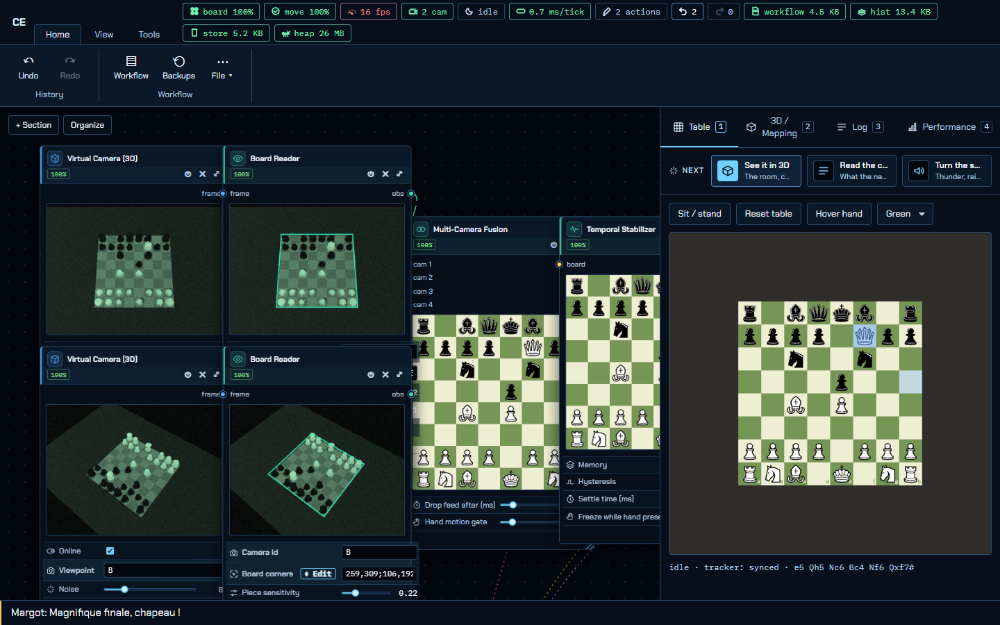
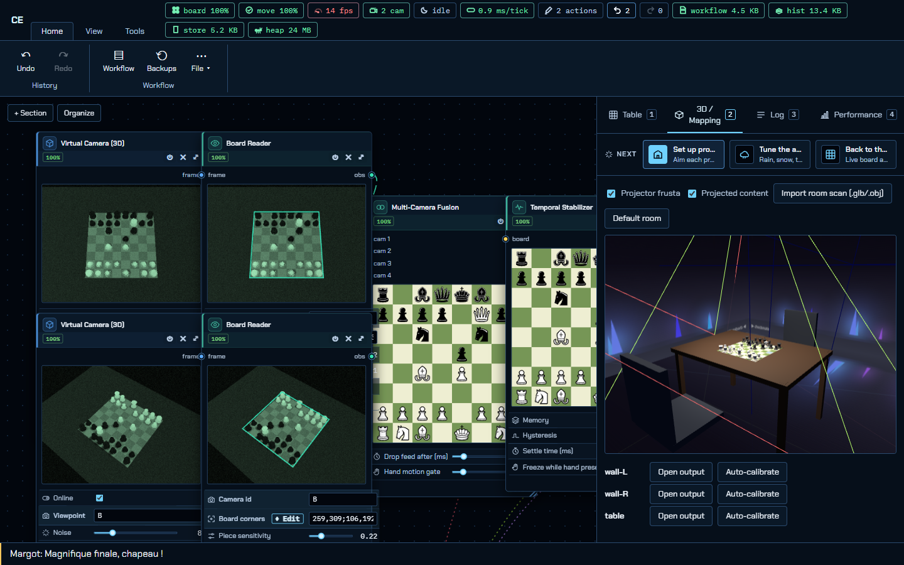
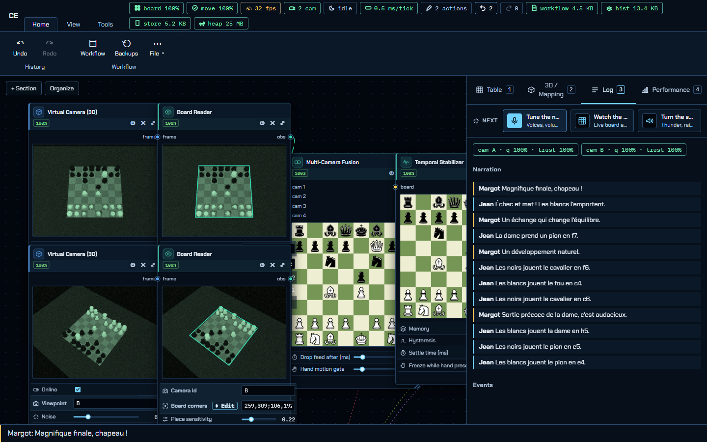
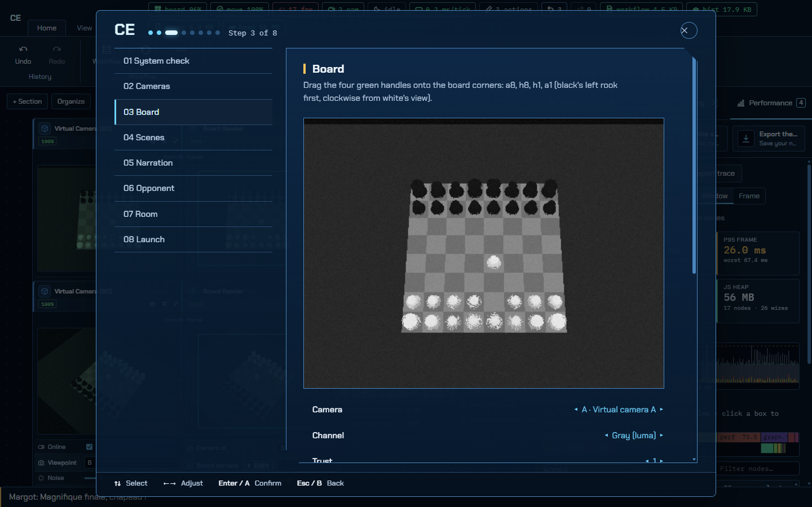
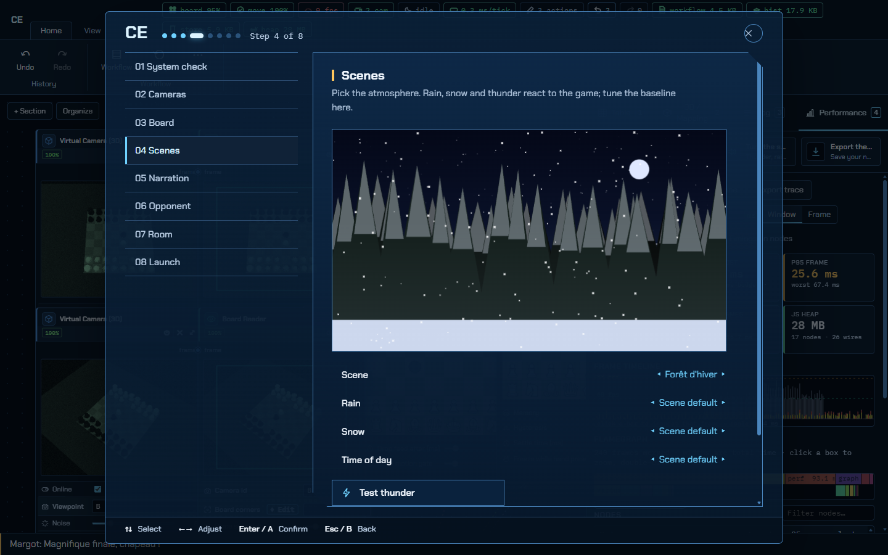

# chess-experience

A nodal, real-time chess table: several webcams (ideally IR-lit) read a physical game with standard
pieces, a legality-checked tracker turns noisy pixels into a clean game state, and that state drives
two-voice narration, Stockfish, weather/decor scenes, DMX and multi-projector mapping of your
(scanned) room. Think Resolume + Chataigne + TouchDesigner/Blueprints, in a browser tab.

<p align="center">
  
</p>

## Screenshots

| | |
| --- | --- |
|  |  |
| **Table.** Two virtual cameras feed the board readers; the tracked board, the 2D view and the next suggestions sit on the right. | **3D / Mapping.** The room, the table and the projector frusta (yellow and red beams), with the wall outputs to calibrate. |
|  |  |
| **Log.** Every move becomes a line of commentary, with each camera's quality and trust. | **Setup, 03 Board.** Drag the four green handles onto a8, h8, h1, a1 on the live preview. |
|  | |
| **Setup, 04 Scenes.** Pick the atmosphere; rain, snow and thunder react to the game. | |

The screenshots were taken from the built-in **virtual cameras**, so they show a real run without hardware.

## Quick start

Requires a recent Node.js LTS and a browser with WebGL (Chromium or Edge recommended).

```bash
npm install
npm run setup:stockfish   # copies the single-thread WASM into public/ (otherwise a weak fallback engine plays)
npm run dev               # http://localhost:5173  -> the guided setup opens by itself
npm test                  # the whole suite, including full-game end-to-end runs
npm run coverage          # same, enforcing 100% lines / branches / functions / statements
npm run check             # typecheck + 100% coverage + production build (what CI runs)
```

## First launch: the guided setup

The first time you open the app, a console-style **configuration menu** takes over (steel-blue,
chamfered panels, glowing selection bar, menu blips). Drive it with the **keyboard** (arrows / Enter /
Esc / PageUp-Down), a **gamepad** (D-pad, A, B, bumpers) or the **mouse**:

| Step | What you do |
| --- | --- |
| 01 Briefing | System check: WebGL, camera access, audio, speech, Stockfish wasm, gamepad. |
| 02 Cameras | Scan and add webcams, or add *virtual* 3D cameras. Toggle each online / offline. |
| 03 Board | Per camera: drag the four green corner handles on the live preview (or nudge with sliders), pick the IR channel, trust and lens field of view. |
| 04 Scenes | Cavern, winter forest, fire watchtower, Christmas forest; rain / snow / time of day; test the thunder. |
| 05 Narration | One or two commentators in French (default) or English, names, volume, test voices. |
| 06 Opponent | Let the player choose at the table (hover menu), or lock Stockfish 500 / 1000 / 1500 or two players. |
| 07 Room | Projector count, **people tracking** (3D pose), DMX bridge. |
| 08 Launch | Validation (errors block launching), optional autoplay demo game, **Launch**. |

The result is saved and turned into a node patch (`setup/config.ts: buildGraphFromConfig`). Reopen it
any time with **⚙ Setup** in the top bar; **Reset patch** forgets everything.

## No hardware? Fake cameras with a real 3D game

Everything runs on **virtual cameras**: a small ray-caster (`sim/render3d.ts`) renders what an IR
camera would see of a game: perspective, tall pieces occluding their neighbours, a hand and forearm
that carry the piece across the board, exposure, lighting falloff and sensor noise, from three
rigs (A overhead, B from black's left, C from the right). Six scripted games (`sim/scenarios.ts`:
Scholar's mate, the Opera Game, queen exchange, both-side castling, en passant, promotion) are played
by a virtual hand through the full patch. Use the **Scenario Player** node or the setup's
*Autoplay demo game*. In the **Table** tab you can also click a piece and a square yourself, sit down,
and hover the mouse over the menu buttons to test dwell selection.

## Phone remote: watch and play from a phone

Run the app on the computer that has the webcam (`npm run dev`, or `start-chess.bat`), open it there as `http://localhost:5173`, and click **Phone** in the ribbon (Home, Start). The window shows an address and a four-digit join code. On a phone on the **same Wi-Fi**, open the address (the code is already in it).

The phone page shows:

- **The game**: the board, live. Step back and forward through the moves with the arrows, or tap any move on the sheet. **Live** returns to the current position.
- **Moves**: a paper score sheet, one row per move number. Tap a move to see that position.
- **Camera**: the latest picture from each camera, about once a second (grayscale, as the tracker sees it). Pictures are only sent while a phone is watching.
- **Game info**: tracker state, confidence, camera health and the narration lines.
- **Playing**: tap a piece, then a green dot. On the virtual table the virtual hand plays the move and the tracker follows it. With a real board and a webcam the move appears as an arrow on the computer's screen (and the projector, if any) and a person plays it on the board; the tracker then confirms it from the camera. Promotions are always to a queen. It is whichever side's turn it is; against a bot you can only play your own side.

How it works: the dev server (`src/remote/relay.ts`, a Vite plugin with no dependencies) relays between the app on the computer and the phone. The app pushes the game state a few times a second; the phone polls. Host routes only answer requests from the computer itself, and phone routes need the join code. The server listens on the network (`server.host` in `vite.config.ts`), so on Windows the first start asks whether Node may use private networks: allow it. The code changes every time the server starts. This is for a home or venue network you trust; there is no encryption, so do not expose the port to the internet.

A static build (the copy on a web host) has no relay, so the Phone button says so.

## Tests: behaviour, and 100 % coverage

`npm run coverage` fails if any line, branch, function or statement in `src/` is untested.
Highlights:

* **Full-system scenario matrix** (`src/e2e.test.ts`): each scripted game runs through *cameras →
  readers → fusion → stabilizer → tracker → narrator / cues* and must reproduce the exact move list,
  captures, castles, promotions, checks, mate, thunder on queen loss and narration. A **safety
  invariant** is checked on every tick: *the tracker never accepts a move that was not played*, even
  under terrible light, noise ×7, falloff, one or three cameras, cameras dropping out mid-game, or
  both cameras blind for seconds.
* Pixel-level tests of the renderer (occlusion, sensor model), homography, fusion, stabilizer.
* Every wizard step, navigation mode, camera scan, corner drag, every node's parameters and error paths,
  the node editor interactions, panels, output window, calibration (with a simulated projector+camera),
  room-scan plane extraction, edge blending maths, DMX/audio/speech/MediaPipe through stubs.

Tests found real bugs while being written (a position comparison that ignored empty squares, a
narrator line that could never fire, a delta clock that never started at `t = 0`); all fixed.

## Look and feel

One token system (`src/style.css`): three ink depths, one line colour, two text tones, a single cyan accent, amber reserved for hints
and warnings. Type is Chakra Petch (UI) and IBM Plex Mono (numbers, values), **bundled via @fontsource so it works offline** at a venue.
The only loud element is the lit selection bar in the setup wizard; node headers are flat with a category stripe; focus
rings are visible; animation is one entrance and respects `prefers-reduced-motion`. Written against Anthropic's
`frontend-design` skill guidance (subject-grounded, restrained, no templated tells such as emoji icons or eyebrow labels).

## The patch

```
Camera A ─ Board Reader ─┐
Camera B ─ Board Reader ─┼─ Fusion ─ Stabilizer ─ Move Tracker ─┬─ Director ─ Stockfish
Webcam (offline) ────────┘                                       ├─ Narrator ─ Speech
                                                                 └─ Scene Cues ─ Audio + DMX
```

Double-click / right-click the canvas to add nodes, drag pins to wire (type-checked, colour-coded),
alt-click a wire to cut it, `⏻` bypasses, wheel zooms, drag pans. Each node shows its cost (ms) and a
0–100 % **fidelity** chip. Patches autosave and export as JSON. New node types are plugins
(`plugins/*.ts`, registered in `plugins/index.ts`).

## How the vision stays consistent on noisy footage

| Trick | Where |
| --- | --- |
| Board homography from 4 corners; per-square centre-patch sampling | `vision/sampler.ts` |
| Empty-square reference learned from the start position, slowly adapted (lighting drift) | `vision/sampler.ts` |
| Per-camera quality + learned **reliability** + user trust; offline / stale cameras stop voting | `vision/fusion.ts` |
| Log-odds fusion; hand / occlusion gate: a camera seeing motion goes mute, the board freezes | `fusion.ts`, `stabilizer.ts` |
| Leaky integration + hysteresis + "settled" quiet-time | `vision/stabilizer.ts` |
| Piece **identity is never read from pixels**: only a legal move (or legal pair, for dropped frames) that explains the observed occupancy/colour is accepted, with a margin over the runner-up and N-frame confirmation | `chess/tracker.ts` |
| **Chess clock**: LCD / phone-app / analog-dial readers give time left with a confidence; a model driven by real timestamps and the moves fills the gaps and its certainty falls until the next read; a Kalman-style fusion with a plausibility gate keeps both honest | `vision/clockReader.ts`, `clock/model.ts`, `plugins/clock.ts` |
| Diagnostics: *lifted* (piece in hand), *illegal* (squares highlighted on the table), fidelity per move | `chess/tracker.ts` |

## Room, projectors, mapping

* **3D / Mapping** tab: room, table, board, chairs, people skeletons, projector frusta, live projected content.
* **Import room scan** (Polycam `.glb` / `.obj`): RANSAC planes → floor / ceiling / walls become projection surfaces.
* **Projectors**: each is a pose + FOV; *Open output* launches a window per projector that renders the room from the
  projector's own viewpoint and **edge-blends overlaps per fragment** (`world/blend.ts`).
* **Auto-calibrate**: black / white / dot sequence seen by a Webcam node → camera→projector homography (outliers rejected)
  and the lit footprint (`mapping/calibrator.ts`, `autocal.ts`).
* **People in 3D**: MediaPipe pose (GPU, lite) per camera, triangulated across cameras (`vision/triangulate.ts`), seat
  detection and wrist-near-table pointers. Switch it on in the setup (Room step). **Each camera's position and aim are
  derived automatically from the board corners you marked** (planar pose estimation on the known 46 cm board,
  `vision/boardPose.ts`), so nothing is typed in; verified to < 1 cm on the three virtual rigs.
* DMX: browsers cannot send UDP, so run `npm run bridge:dmx [artnet-ip]` and enable DMX in the setup.

## Own repository

This folder is self-contained. To move it into its own repo, keeping history:

```bash
scripts/split-to-new-repo.sh git@github.com:YOU/chess-experience.git   # target repo must be empty
```

## Frugality (GTX 1060 mobile)

Graph ticks at 15 Hz; vision samples 64 small patches per camera instead of whole frames; virtual cameras re-cast rays
only when something moves; scenes are procedural Canvas2D with capped particles; audio is synthesised; Stockfish is the
single-thread lite WASM; the 3D tab renders only while visible; pose is optional and round-robins cameras.

## Known limits

* Real webcams, real IR lighting, MediaPipe on real footage, DMX fixtures and physical projectors have not been
  exercised (no hardware here): they are covered through the virtual cameras and stubs. Expect to tune *Piece Δ*,
  the corner positions and the camera field of view on first contact.
* The wizard and the main app were checked in headless Chromium (no console errors; Halo menu, node editor, table and
  3D tabs, and a live scripted demo game tracked end to end); projector output windows were not opened.

## Themes
View → Theme picks one of five looks (Classic, Nodes, Engine, Studio, Glass); the mode button cycles Dark / Light / System. Token sets live in `src/ui/theme.css`; state in `src/ui/appTheme.ts`.
